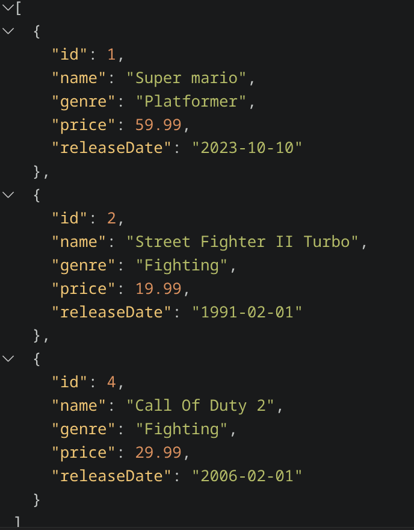
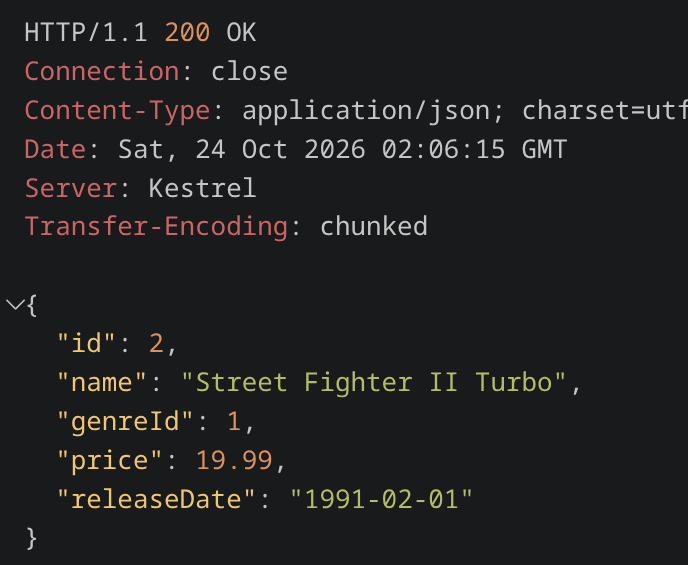
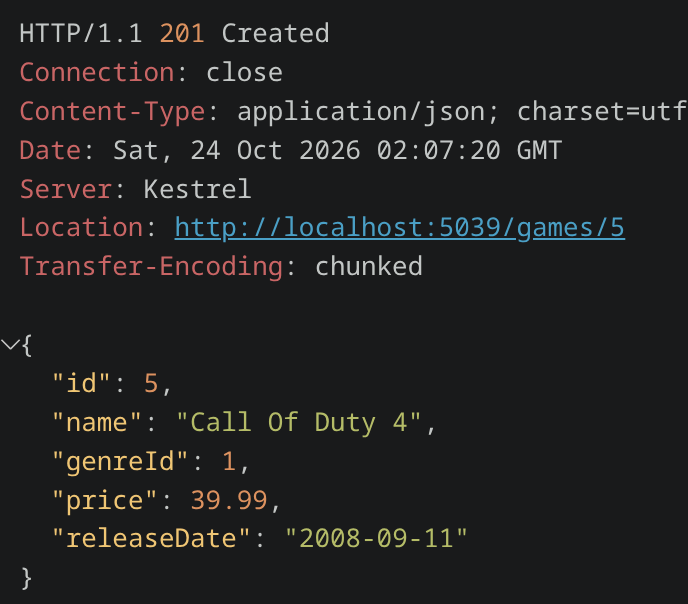
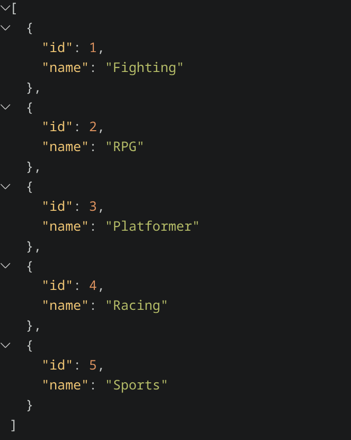

# GameStore API

A RESTful API built with **C# and ASP.NET Core Minimal APIs** for managing video game records and their genres. Data is stored in **SQLite** using **Entity Framework Core**.

## Features

- Implement CRUD operations for game management
- Retrieve all available game genres
- Persist game data using SQLite and EF Core with asynchronous database operations
- Apply database migrations automatically at startup
- Seed the database with predefined genres
- Validate API requests using `AddValidation()`

## Tech Stack

| Technology | Purpose |
| --- | --- |
| C# / .NET 10 | Language and runtime |
| ASP.NET Core Minimal APIs | API development |
| Entity Framework Core | ORM and data access |
| SQLite | Local database |
| EF Core Migrations | Schema management and seeding |
| `.http` file | Manual endpoint testing |

## Screenshots

### Get All Games



### Get Game by ID



### Create New Game



### Get All Genres



## Getting Started

### Prerequisites

- [.NET 10 SDK](https://dotnet.microsoft.com/download/dotnet/10.0)
- Git

### 1. Clone the repository

```bash
git clone https://github.com/code-with-nazmul/GameStore.git
cd GameStore
```

### 2. Restore dependencies

```bash
dotnet restore
```

### 3. Restore local tools

The project uses `dotnet-ef` as a local tool (see `config/dotnet-tools.json`):

```bash
dotnet tool restore
```

### 4. Apply migrations

Migrations run automatically when the app starts via `app.MigrateDb()`. You can also apply them manually:

```bash
dotnet ef database update
```

This creates or updates `GameStore.db` and seeds the genre data, according to the project's database initialization and seeding configuration.

### 5. Run the app

```bash
dotnet run
```

Note the local URL printed in the console (for example, `http://localhost:5039`). Use your actual URL and port for the requests below.

## API Endpoints

### Games

| Method | Endpoint | Description |
| --- | --- | --- |
| `GET` | `/games` | List all games (summary) |
| `GET` | `/games/{id}` | Get a game by ID |
| `POST` | `/games` | Create a game |
| `PUT` | `/games/{id}` | Update a game |
| `DELETE` | `/games/{id}` | Delete a game |

### Genres

| Method | Endpoint | Description |
| --- | --- | --- |
| `GET` | `/genres` | List all genres |

## Testing the API

The repository includes a `games.http` file with ready-to-send requests for the endpoints. Open it in VS Code with the REST Client extension, or use another HTTP client, and send requests to your local API URL.

The examples below use port `5039`. Replace it if your application starts on a different port.

```http
@baseUrl = http://localhost:5039

### Get all games
GET {{baseUrl}}/games

### Get a game by ID
GET {{baseUrl}}/games/3

### Create a game
POST {{baseUrl}}/games
Content-Type: application/json

{
  "name": "TEST GAME",
  "genreId": 1,
  "price": 9.99,
  "releaseDate": "1991-02-01"
}

### Update a game
PUT {{baseUrl}}/games/2
Content-Type: application/json

{
  "name": "Street Fighter II Turbo",
  "genreId": 1,
  "price": 19.99,
  "releaseDate": "1991-02-01"
}

### Delete a game
DELETE {{baseUrl}}/games/3

### Get all genres
GET {{baseUrl}}/genres
```

## Project Structure

```text
GameStore/
├── config/
│   └── dotnet-tools.json
├── Data/
│   ├── DataExtensions.cs
│   ├── GameStoreContext.cs
│   └── Migrations/
├── Dtos/
│   ├── CreateGameDto.cs
│   ├── GameDetailsDto.cs
│   ├── GameSummaryDto.cs
│   ├── GenreDto.cs
│   └── UpdateGameDto.cs
├── Endpoints/
│   ├── GameEndPoints.cs
│   └── GenresEndpoints.cs
├── Models/
│   ├── Game.cs
│   └── Genre.cs
├── Properties/
│   └── launchSettings.json
├── screenshots/
│   ├── get-all-games.png
│   ├── get-game-by-id.png
│   ├── create-new-game.png
│   └── get-all-genres.png
├── appsettings.json
├── appsettings.Development.json
├── GameStore.API.csproj
├── games.http
├── GameStore.db
├── Program.cs
└── README.md
```

## Author

**Md. Nazmul Hasan**

- GitHub: [@code-with-nazmul](https://github.com/code-with-nazmul)
- Repository: [GameStore](https://github.com/code-with-nazmul/GameStore)
